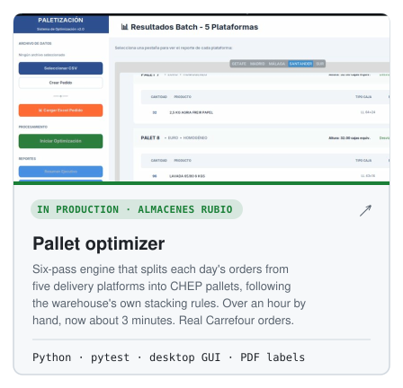
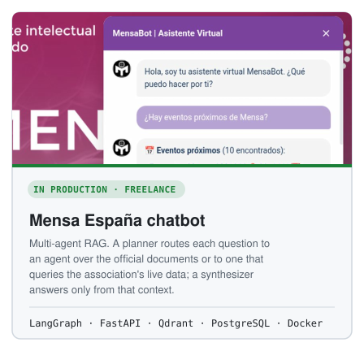
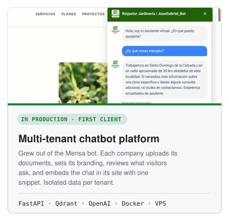
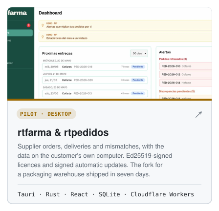
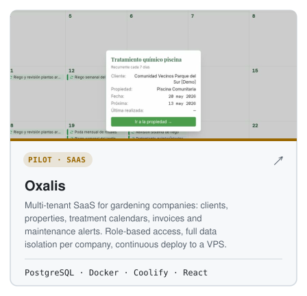
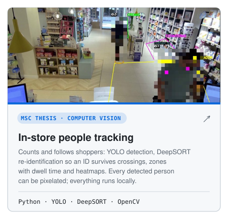
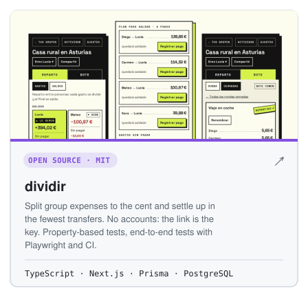
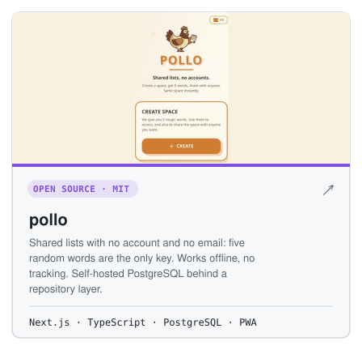

<!-- Generated by tools/build.py from tools/profile.toml. Edit those, not this file. -->

<picture><source media="(prefers-color-scheme: dark)" srcset="assets/header-dark.svg"></picture>

I build software and AI systems that solve one concrete problem, and I take them to production.

Agricultural engineer by training, I spent ten years automating a food-processing plant before an MSc in Big Data and Data Science (neural networks and deep learning) took me into AI. Since 2026 I work on my own as a software and AI engineer.

I'm looking for an AI, data or software team where I can build systems people actually use, and learn from engineers with more road behind them.

### Systems I've built

<a href="https://github.com/patatapython/paletizador-optimizer"><picture><source media="(prefers-color-scheme: dark)" srcset="assets/card-paletizador-dark.svg"></picture></a>
<picture><source media="(prefers-color-scheme: dark)" srcset="assets/card-mensa-dark.svg"></picture>
<picture><source media="(prefers-color-scheme: dark)" srcset="assets/card-chatbots-dark.svg"></picture>
<a href="https://rtfarma.com"><picture><source media="(prefers-color-scheme: dark)" srcset="assets/card-rtfarma-dark.svg"></picture></a>
<a href="https://oxalis.fit"><picture><source media="(prefers-color-scheme: dark)" srcset="assets/card-oxalis-dark.svg"></picture></a>
<a href="https://github.com/patatapython/Sistema-Tracking-Farmacia"><picture><source media="(prefers-color-scheme: dark)" srcset="assets/card-tracking-dark.svg"></picture></a>

### Open source

<a href="https://github.com/patatapython/dividir"><picture><source media="(prefers-color-scheme: dark)" srcset="assets/card-dividir-dark.svg"></picture></a>
<a href="https://github.com/patatapython/pollo"><picture><source media="(prefers-color-scheme: dark)" srcset="assets/card-pollo-dark.svg"></picture></a>

Also on GitHub: [link-cleaner-pro](https://github.com/patatapython/link-cleaner-pro), a Chrome extension that strips tracking from links locally, and [rosa-de-los-vientos](https://github.com/patatapython/rosa-de-los-vientos), wind roses from 976 Spanish weather stations.

### How I work

- Tests from the start, continuous integration, Docker, and strict typing where it matters.
- AI-assisted development with Claude Code, with review and tests for everything that goes in. The architecture, product and stack decisions are mine.

### Toolbox

<picture><source media="(prefers-color-scheme: dark)" srcset="assets/toolbox-dark.svg"></picture>

### About what you can't see here

Most of my work is client software and lives in private repositories. What is public are finished portfolio versions, which is why some of them have few commits. Happy to walk through any of this code in as much depth as you want.

---

<a href="https://www.linkedin.com/in/guillermomanzanares">LinkedIn</a> · <a href="https://epitrixconsulting.com">epitrixconsulting.com</a>

